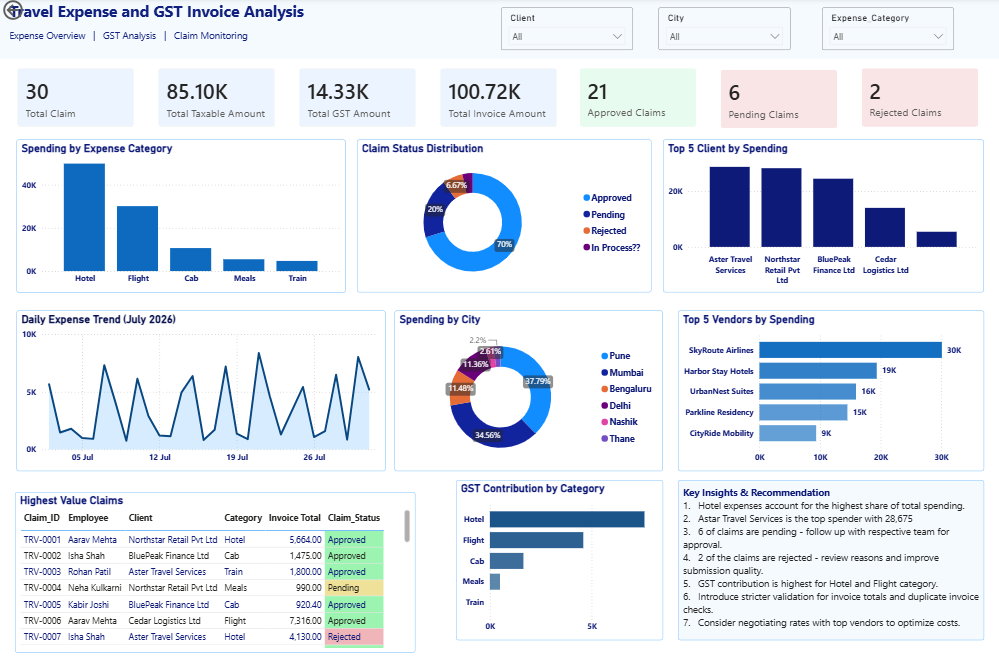

# Travel Expense & GST Invoice Analysis

## Short Description / Purpose
Analyzed travel expense claims and GST invoices to monitor business spending, evaluate claim statuses, and validate invoice amounts. Developed an interactive Power BI dashboard to support expense tracking and financial decision-making.

## Tech Stack
- **SQL (MySQL):** Data querying, aggregation, and business analysis.
- **Python (Pandas):** Data cleaning, preprocessing, and data validation.
- **Power BI:** Interactive dashboard development, KPI tracking, and data visualization.
- **Excel/CSV:** Dataset storage and initial data handling.

## Features / Highlights
- Analyzed total claims, taxable amounts, GST, and invoice values.
- Evaluated expense patterns by category, client, vendor, and city.
- Monitored approved, pending, and rejected claims.
- Analyzed daily expense trends to identify high-spending dates.
- Compared GST amounts and invoice totals to identify discrepancies.
- Created interactive KPI cards, charts, tables, and slicers in Power BI.

## Business Impact & Insights
- Identified high-spending expense categories and clients for cost monitoring.
- Improved visibility into claim statuses and outstanding approvals.
- Supported GST and invoice validation by highlighting potential discrepancies.
- Enabled data-driven expense monitoring through an interactive dashboard.

## Dashboard Screenshot

